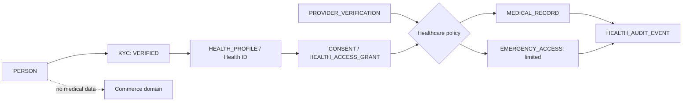

# COME IN IT Health — Baseline Integration Map

**الحالة:** قرار معماري قبل التنفيذ  
**النطاق:** Phase 2 — Healthcare Bounded Domain  
**الحكم:** قابل للدمج بشروط عزل صارمة؛ لا تعديل على تسلسل الثقة التجاري أو كيانات العرض والمطابقة والتجارة.

> **المبدأ الحاكم:** هوية واحدة متحققة، ونطاقات موثوقة متعددة، وبيانات يتحكم فيها المستخدم، ووصول قائم على الغرض، وتدقيق كامل.

## 1. نتيجة تحليل الـBaseline

الـBaseline الحالي يثبت فصل الهوية الشخصية عن الكيان التجاري عبر `PERSON → KYC_RECORD → VERIFIED_IDENTITY`، ثم يربط الكيان التجاري بـ `BUSINESS_ENTITY → KYB_RECORD → BUSINESS_MEMBERSHIP`. كما أن العلاقات التجارية تبدأ بعد طبقة الأدوار والأذونات والعروض والمطابقة، وتنتهي بالعقود والطلبات والمعاملات وسجل التدقيق. لذلك لا يجوز جعل `KYC` أو `KYB` تفويضاً صحياً؛ بل يُعاد استخدام الهوية المتحققة حصراً كمرجع لإنشاء `HEALTH_PROFILE`.

| مجال Baseline قائم | قرار الدمج | سبب عدم الانكسار |
|---|---|---|
| `PERSON` و`KYC_RECORD` و`VERIFIED_IDENTITY` | **إعادة استخدام مرجعية فقط** | Health ID يتطلب KYC متحققاً، لكنه لا يقرأ ولا ينسخ وثائق KYC أو حالتها التفصيلية. |
| `BUSINESS_ENTITY` و`KYB_RECORD` | **لا توسعة تجارية** | KYB لا يثبت رخصة ممارسة صحية؛ يضاف `HEALTHCARE_PROVIDER` و`PROVIDER_VERIFICATION` بصورة مستقلة. |
| `BUSINESS_MEMBERSHIP` و`ROLE` و`PERMISSION` | **طبقة أذونات صحية مستقلة** | الأدوار التجارية لا تمنح وصولاً طبياً. يمكن أن يشير provider إلى شخص أو كيان دون نقل صلاحياته. |
| `PRODUCT` و`SERVICE` و`USED_ASSET` و`DEMAND` | **فصل صريح** | لا مفاتيح أجنبية أو مسارات API أو فهارس مشتركة مع السجل الصحي. |
| `MATCH` و`OFFER` و`NEGOTIATION` و`CONTRACT` و`ORDER` و`TRANSACTION` | **خارج النطاق** | لا يظهر السجل الصحي في المطابقة أو التجارة أو التسويق أو التحليلات التجارية. |
| `NOTIFICATION` و`AUDIT_LOG` | **لا علاقة علائقية عابرة للنطاق** | الإشعار لا يكشف بيانات صحية. يحتفظ النطاق الصحي بسجل الوصول الخاص به؛ ويمكن إصدار حدث WORM عام بلا مفتاح أجنبي من الصحة إلى التدقيق التجاري. |

## 2. حدود Healthcare Bounded Domain

يقترح الدمج نطاقاً صحياً مستقلاً يحمل تصنيف `highly_sensitive_health`، ويستخدم مخزناً منطقياً وسياسات استعلام وإجراءات API مخصصة. الحافة العلائقية الوحيدة إلى Core هي `person_id` بعد KYC المتحقق. معرّفات مقدم الخدمة وسجل الوصول كيانات داخلية في نطاق Health، وأي حدث WORM عام يصدر بلا FK عابر للنطاق. لا تُنسخ أي قيمة طبية إلى الملف التجاري أو محرك المطابقة أو مستودع التحليلات العام.

## 3. نموذج الكيانات الأدنى

| كيان جديد | الغرض | علاقة آمنة بالـBaseline | تصنيف البيانات |
|---|---|---|---|
| `HEALTH_PROFILE` | Health ID خاص بالشخص بعد KYC متحقق | `person_id` فقط | Highly Sensitive Health |
| `HEALTHCARE_PROVIDER` | تمثيل مهني أو منشأة صحية منفصل عن الكيان التجاري | نطاق صحي مستقل؛ لا FK إلى Business أو Government Entity | Restricted |
| `PROVIDER_VERIFICATION` | تحقق الترخيص/المنشأة الصحي | `provider_id` فقط؛ لا يعتمد على KYB وحده | Confidential-Sovereign |
| `MEDICAL_RECORD` | سجل سريري معياري ذي مصدر وإصدار وحالة تحقق | `health_profile_id` و`provider_id` اختياريان | Highly Sensitive Health |
| `MEDICAL_RECORD_AMENDMENT` | تصحيح إصدار دون حذف الأصل | `record_id` و`supersedes_record_id` | Highly Sensitive Health |
| `HEALTH_CONSENT` | موافقة غرض/نطاق/مدة قابلة للإلغاء | `patient_profile_id` و`provider_id` و`facility_id` | Highly Sensitive Health |
| `HEALTH_ACCESS_GRANT` | رمز مشاركة مؤقت مشتق من موافقة | `consent_id` فقط، مع hash للرمز | Highly Sensitive Health |
| `EMERGENCY_ACCESS` | Break-glass محدود لبيانات الطوارئ | `profile_id` و`provider_id` وسبب إلزامي | Highly Sensitive Health |
| `HEALTH_AUDIT_EVENT` | تدقيق تفصيلي لكل عرض/إنشاء/تعديل/طوارئ | `profile_id` و`consent_id` ومراجع ممثلين | Highly Sensitive Health |

## 4. قرارات عدم الكسر

لا تتغير أسماء أو دلالات أو علاقات الكيانات التجارية القائمة. يبقى التسلسل التجاري: `PERSON → KYC → VERIFIED_IDENTITY → BUSINESS_ENTITY → KYB → MEMBERSHIP → ROLE → PERMISSION → OFFERING → MATCHING → TRADE → AUDIT`. ويضاف التسلسل الصحي بصورة موازية لا متداخلة: `PERSON → [KYC eligibility gate] → HEALTH_PROFILE → HEALTH_CONSENT → HEALTH_ACCESS_GRANT → MEDICAL_RECORD → HEALTH_AUDIT_EVENT`.

لا يتغير أي من WF-001 إلى WF-030. تضاف عائلة مستقلة من `HLTH-001` إلى `HLTH-024` دون إعادة تعريف معنى KYC أو KYB أو أدوار التجارة. وبالمثل، تكون `HEALTHCARE_PROVIDER` و`PROVIDER_VERIFICATION` إضافات مستقلة، لا امتدادات لـ `SERVICE` أو `SERVICE_VERIFICATION`، لأن السجل الصحي وموافقاته يتطلبان عزلًا قانونياً وتقنياً وغايات وصول مختلفة.

## 5. بوابات الوصول وسياسات العزل

يجب أن يمر كل طلب صحي بالترتيب التالي: مصادقة → ربط الشخص أو مقدم الخدمة → تحقق مقدم الخدمة الصحي → دور صحي → موافقة نشطة ومطابقة للغرض والنطاق والزمن → سياسة ABAC → قرار → تدقيق. لا تعطي KYC أو KYB أو العضوية التجارية أو الوصول إلى B2B/B2G أية صلاحية ضمن هذا التسلسل.

| حالة الطلب | القرار | أثر تدقيق إلزامي |
|---|---|---|
| مريض متحقق ينشئ Health ID | يسمح من دون منح مقدم خدمة أي وصول | `HEALTH_PROFILE_ACTIVATED` |
| مقدم خدمة غير متحقق | يرفض | `HEALTH_ACCESS_DENIED_PROVIDER` |
| مقدم خدمة متحقق بلا موافقة نشطة | يرفض | `HEALTH_ACCESS_DENIED_CONSENT` |
| موافقة منتهية أو ملغاة | يرفض فوراً | `HEALTH_ACCESS_DENIED_EXPIRED_OR_REVOKED` |
| موافقة نشطة لكن نطاقها جزئي | يعرض النطاق المصرح فقط | `HEALTH_ACCESS_GRANTED_SCOPED` |
| Break-glass مصرح بسبب إلزامي | يعرض مجموعة الطوارئ فقط | `HEALTH_BREAK_GLASS_USED` مع تنبيه ومراجعة |

## 6. أثر التنفيذ الحالي

تنفيذ Phase 2 يبدأ بهياكل البيانات، المسارات المحمية، ولوحات واجهة توضيحية غير سريرية. لا يتيح عمليات صحية حقيقية، ولا يدعي امتثالاً تنظيمياً أو اتصالاً بالجهات الصحية أو صحة التراخيص أو تخزين مستندات طبية حقيقية. تبقى الملفات الطبية، إن أضيفت لاحقاً، في تخزين سيادي منفصل مع مفاتيح وإجراءات إدارة وصول معتمدة.

## 7. تسلسل التنفيذ المعتمد

يتم أولاً إنشاء الحزمة الكنسية الصحية والـERD المنفصل. ثم يضاف مخطط Drizzle في جداول صحية مستقلة مع migrations إضافية فقط. بعد ذلك تنفذ إجراءات tRPC وحواجز التحقق والموافقة، تليها واجهة Health Dashboard حالتية لا تعرض أي بيانات صحية خام في غير سياقها. وأخيراً تضاف اختبارات لاختراق العزل والتحولات غير المسموحة والموافقة المنتهية والطوارئ وإصدارات التصحيح.

## 8. معايير قبول عدم الانكسار

يبقى `businesses.*` و`bookmarks.*` و`kyc.*` و`kyb.*` دون تغيير دلالي. لا يحصل مستخدم تجاري يحمل KYB على أي استجابة صحية دون دور مقدم خدمة متحقق وموافقة صحية سارية. لا تظهر الحقول الصحية في استجابات `products` أو `services` أو `demands` أو `matches` أو في بيانات التحليلات التجارية. وتنجح migrations القائمة والاختبارات الحالية دون إسقاط أو تعديل مدمر للبيانات.

## 9. قرار التنفيذ

**APPROVED WITH CONDITIONS.** يوافق الدمج المعماري فقط بوصفه نطاقاً صحياً مستقلاً في Phase 2، وعلى أساس المراجع والحد الأدنى من البيانات والموافقة الصريحة والتدقيق الكامل. ويتطلب تشغيل عمليات صحية حقيقية اعتماداً تنظيمياً وأمنياً وترخيصياً وتكاملاً مع مقدمي رعاية معتمدين لاحقاً.
