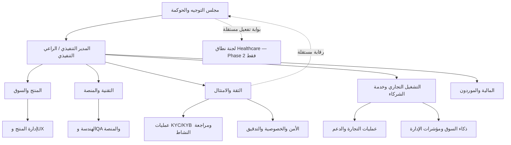

# COME IN IT — مواصفة الهيكل الإداري والتنفيذي

**الإصدار:** 1.0  
**الحالة:** مسودة تشغيلية لاتخاذ قرار التأسيس والتوظيف  
**النطاق:** تنفيذ المنصة من مرحلة MVP حتى التشغيل المؤسسي، مع بقاء الربط الحكومي الفعلي والمدفوعات والاعتماد التنظيمي النهائي خارج النطاق الحالي.

## 1. الغرض والحكم التنفيذي

هذه الوثيقة تحدد **نموذج التشغيل الإداري** المطلوب لتحويل COME IN IT من مواصفة ومنصة قائمة إلى منتج تشغيلي منضبط. وهي لا تقترح «إدارة سوق إلكتروني» تقليدية؛ بل تنظّم مسؤولية واضحة عن سلسلة الثقة: الهوية، والتحقق، والكيان، والدور، والصلاحية، وهوية العرض، وأهلية العلاقة، والمطابقة، والتدقيق. وهذا الفصل ضروري لأن المنصة لا تسمح للتجاري أو للمبيعات بتجاوز بوابات الثقة أو بتقرير التحقق بأنفسهم. [1]

> **المبدأ الحاكم:** تكون الملكية التجارية للفرصة في وحدة الأعمال، بينما يبقى قرار الثقة والامتثال مستقلاً عنها، وتبقى سلامة المنصة وأمنها وقرارات النشر تحت مسؤولية تقنية قابلة للمساءلة.

يناسب هذا النموذج الحكم الحالي للمنصة، وهو **READY WITH CONDITIONS**: يمكن بناء وتشغيل MVP منضبط، لكن الإعلان عن جاهزية تنظيمية أو B2G فعلي أو خدمات صحية حقيقية لا يتم إلا بعد إغلاق الشروط والأدلة المطلوبة. [1]

| طبقة الحوكمة | الهدف | نوع القرار |
|---|---|---|
| مجلس التوجيه والحوكمة | حماية الاتجاه الاستثماري والسيادي والمخاطر الكبرى | اعتماد المراحل والميزانية والمخاطر غير المقبولة |
| الإدارة التنفيذية | تحقيق أهداف المنتج والسوق والتشغيل | الأولويات، التوظيف، الموردون، مؤشرات الأداء |
| المنتج والتقنية | بناء خدمة قابلة للتشغيل والتوسع | خارطة الطريق، التصميم، النشر، الجودة |
| الثقة والامتثال | حماية شروط KYC/KYB والصلاحيات والتدقيق | سياسات التحقق، الاستثناءات، التعليق والتصعيد |
| التجارة والعمليات | تشغيل الموردين والطلب والمطابقة وخدمة العملاء | حالات التشغيل ضمن حدود الصلاحية المعتمدة |

## 2. مبادئ التصميم التنظيمي

يجب أن يعكس الهيكل الإداري فصل `PERSON` عن `BUSINESS_ENTITY`، وتعدد الممثلين المفوضين، وعدم منح الوصول التجاري قبل اكتمال البوابات ذات الصلة. لذلك لا تكون «الموافقة على عميل تجاري» أو «إتاحة المطابقة» قرار مبيعات منفرداً؛ بل قراراً تشغيلياً مقيداً بحالة تحقق وعضوية ونشاط وعرض وعلاقة. [1]

| المبدأ | تطبيقه التنظيمي | الحظر الصريح |
|---|---|---|
| استقلال الثقة | رئيس الثقة والامتثال يرفع للمدير التنفيذي أو لجنة المخاطر، لا لمدير المبيعات | ربط مكافأة مراجعي KYC/KYB بعدد الموافقات أو GMV |
| فصل الواجبات | من يطور لا يعتمد نشره؛ ومن يراجع لا يغير الأثر التدقيقي | موافقة ذاتية على الإنتاج أو تعديل سجل WORM |
| المنتج قبل الواجهة | مدير المنتج مسؤول عن قرار النطاق ومعايير القبول لا عن تسليم التصميم فقط | بناء شاشة أو تكامل قبل تعريف مالك حالة وقرار فشل |
| سيادة البيانات بالتصميم | مسؤول أمن/خصوصية يوافق على التصنيف ومسار البيانات والمورد الحساس | نقل بيانات Restricted أو Confidential-Sovereign لتجربة غير معتمدة |
| Health كحد مستقل | مسؤول نطاق صحي مستقل عند تفعيل Phase 2 | استخدام أدوار التجارة أو KYB لمنح وصول إلى بيانات صحية |
| إنسان في الاستثناء | `manual_review` لها مالك وسجل سبب وSLA وتصعيد | معالجة يدوية غير مسجلة أو تحويلها إلى قرار تجاري غير موثق |

## 3. الهيكل المستهدف

يقترح الهيكل التالي طبقات مسؤولية واضحة. في البداية يمكن جمع بعض المناصب في أشخاص محدودين، لكن لا يجوز جمع الأدوار التي تتعارض رقابياً، خصوصاً المبيعات مع اعتماد الثقة، والتطوير مع اعتماد النشر، ومالك البيانات مع تدقيق استخدامه.

### 3.1 مجلس التوجيه والحوكمة

يتكون المجلس في مرحلة التأسيس من الراعي الاستثماري أو المؤسس، والمدير التنفيذي، ومستشار قانوني/تنظيمي مستقل، وخبير أمن أو سيادة بيانات، وعضو بخبرة تجارة أو سلاسل إمداد. المجلس ليس فريق تشغيل يومي؛ بل يعتمد المخاطر الكبرى، ونقل النظام بين المراحل، وإطلاق نطاقات حساسة، والتعاقدات ذات الأثر السيادي.

| القرار المحجوز للمجلس | مالك الإعداد | المدخلات الإلزامية | مخرج القرار |
|---|---|---|---|
| انتقال Pilot إلى إطلاق إنتاجي | المدير التنفيذي | معايير قبول، نتائج أمن، قدرة تشغيل، سجل فجوات | اعتماد مشروط أو تأجيل |
| اعتماد سياسة بيانات أو مورد حساس | رئيس التقنية ورئيس الثقة | تصنيف بيانات، تقييم خطر، أثر تعاقدي | قبول أو رفض أو ضوابط إضافية |
| فتح B2G أو Healthcare فعلي | المدير التنفيذي ولجنة النطاق | قانوني، أمني، تشغيلي، أدلة صلاحية | قرار بوابة مستقل |
| قبول مخاطرة جوهرية أو استثناء دائم | رئيس الثقة والامتثال | سبب، أثر، مدة، خطة معالجة | قرار موثق ومحدد المدة |

### 3.2 الإدارة التنفيذية

يتحمل **المدير التنفيذي أو الراعي التنفيذي** المساءلة عن القيمة الاستثمارية والالتزام بالنطاق والموارد، بينما يقود مدير المنتج الأولويات السوقية، ويقود المدير التقني قابلية البناء والتشغيل، ويملك رئيس الثقة والامتثال حق إيقاف أو تقييد مسار يخرق بوابات الهوية أو البيانات أو التدقيق. لا يحل أي منهم محل الآخر.

| الدور | الولاية الأساسية | صلاحيات القرار | مؤشرات المساءلة | تعارض لا يقبل الجمع |
|---|---|---|---|---|
| المدير التنفيذي / الراعي التنفيذي | الاستراتيجية والتمويل والشراكات والنتيجة الكلية | اعتماد الأولوية والميزانية وتعيين القيادات | إنجاز المرحلة، الانضباط المالي، إغلاق المخاطر | لا يعتمد بنفسه استثناءات الثقة التي تخص شريكاً تجارياً تابعاً له |
| رئيس المنتج والسوق | مشكلة العميل، الأنماط التجارية، خارطة الطريق | ترتيب الأولويات ومعايير قبول المنتج | تبني المسارات، جودة اكتشاف المشكلة، زمن التعلم | لا يعتمد KYC/KYB أو استثناءات البيانات |
| المدير التقني | الهندسة، المعمارية، الاستمرارية، قابلية النشر | معايير التقنية، التغييرات المعمارية، جاهزية الإنتاج | الجودة، الاعتمادية، الدين التقني، الاستجابة للحوادث | لا يراجع أثره التدقيقي أو يعتمد نشره منفرداً |
| رئيس الثقة والامتثال | التحقق، الصلاحيات، الخصوصية، التدقيق، النزاهة | تعليق أو رفض مسار غير مؤهل، اعتماد سياسة تشغيلية | جودة القرار، الالتزام بالسياسات، زمن المراجعة | لا يملك هدف مبيعات أو حافز تحويل تجاري |
| رئيس العمليات التجارية | نجاح الشركاء، عمليات الطلب والمطابقة، الدعم | تشغيل الحالات المعتمدة وتصعيد الاستثناءات | زمن المعالجة، جودة التجربة، الالتزام بالإجراءات | لا يرفع بوابة ثقة أو يغير قرار علاقة |

## 4. وحدات التنفيذ ومواصفات أدوارها

### 4.1 المنتج والسوق

تترجم هذه الوحدة الاحتياج التجاري إلى مسارات عمل قابلة للاختبار. وهي مسؤولة عن تعريف قيمة كل نمط تجارة، وحدود تجربة المستخدم، ومتطلبات البيانات، ومعيار القبول قبل أن تبدأ الهندسة. يجب أن تتعامل مع B2B وB2C وC2B وC2C وB2G كمسارات علاقة تحكمها بوابات، لا كعلامات تسويقية للحسابات. [1]

| الدور | الحد الأدنى للمسؤولية | مخرجات قابلة للمراجعة | مستوى التوظيف |
|---|---|---|---|
| مدير المنتج | امتلاك خارطة الطريق وتحديد الأولويات وAcceptance Criteria | PRD، حالات استعمال، قرار نطاق، سجل فرضيات | بدوام كامل من البداية |
| مصمم UX/UI | واجهات واضحة للعربية والهواتف ومسارات الثقة | Prototype، design system، اختبارات قابلية استخدام | جزئي ثم كامل في Pilot |
| مدير السوق والشراكات | تحقق من المشكلة، القطاعات المستهدفة، تصميم تجربة الشريك | ICP، فرضيات تسعير، برنامج Pilot | جزئي في MVP ثم كامل |
| محلل ذكاء سوق | مؤشرات مجمعة بلا كشف بيانات مقيدة | تعريف KPI ولوحات مؤشرات وسياسة استهلاك البيانات | مرحلة Pilot أو الإنتاج |

### 4.2 التقنية والمنصة

تملك وحدة التقنية التنفيذ من مخطط البيانات إلى النشر والمراقبة. لا يكفي نجاح الواجهة؛ يلزم عقود API، اختبارات، إدارة أسرار، نسخ احتياطية، وخطة استجابة للحوادث قبل الإطلاق الإنتاجي. وتبقى بوابات الحكومة والمدفوعات ومزود السحابة النهائي خارج نطاق التنفيذ إلى حين قرار مستقل. [1]

| الدور | الولاية | الصلاحيات التشغيلية | الحد الأدنى في MVP |
|---|---|---|---|
| قائد هندسي / Architect | ترجمة المعمارية إلى قرارات تنفيذية قابلة للصيانة | مراجعة التصميم وتجزئة التسليمات | 1 بدوام كامل |
| مهندس Backend | الهوية، الكيانات، قواعد التجارة، API، التدقيق | تنفيذ الخدمات والاختبارات التكاملية | 1–2 بدوام كامل |
| مهندس Frontend | المواصفة الحية وتجارب الدور ولوحات العمليات | تنفيذ الواجهة وA11y واختبارات الواجهة | 1 بدوام كامل |
| مهندس منصة وDevOps | CI/CD، البيئات، المراقبة، النسخ، الأسرار | تنفيذ النشر ضمن سياسة الموافقات | 0.5–1 بدوام كامل |
| قائد QA / Test Engineer | خطة الاختبار والقبول والانحدار | رفض إصدار غير مستوفٍ للمعيار | 0.5 في MVP ثم 1 |
| مسؤول أمن وخصوصية / DPO | Threat model، تصنيف البيانات، مراجعة الموردين والحوادث | وقف مسار غير آمن وتحديد ضوابط الوصول | مستشار مستقل ثم 0.5–1 |

### 4.3 الثقة والامتثال

هذه الوحدة هي الجسر بين قواعد النظام والقرار البشري. تدير مراجعات KYC/KYB، والتحقق التشغيلي للنشاط، وقرارات العلاقة ذات `manual_review`، ومراجعة الأحداث الحساسة. ويجب أن تستند كل حالة إلى سياسة معلنة وسبب وتاريخ ومراجع قرار، لا إلى مراسلات أو أوامر شفهية. [1]

| الدور | المسؤولية | ما يملك اعتماده | ما لا يملكه |
|---|---|---|---|
| قائد الثقة والامتثال | سياسة التحقق والتصعيد وإدارة المخاطر التشغيلية | قبول سياسة أو تعليقها، وقبول استثناءات محددة المدة | إلغاء ضوابط تقنية أو تعديل WORM |
| قائد عمليات KYC/KYB | توزيع الحالات وضبط الجودة والتصعيد | اعتماد الحالة ضمن حدود السياسة | تقرير المنتج أو فرض تحويل تجاري |
| محلل تحقق | فحص الطلبات والأدلة الوصفية وتسجيل السبب | توصية قبول أو رفض أو طلب استكمال | اعتماد حالته الخاصة أو تغيير عضوية تجارية |
| محلل علاقات تجارية | معالجة `manual_review` وتوثيق قرار العلاقة | قرار ضمن قواعد الأنماط المعتمدة | تجاوز الرفض الحتمي أو فتح B2G فعلي |
| محلل تدقيق ومخاطر | مراجعة عينات السجل والاستثناءات | إنشاء قضية تدقيق وطلب تصحيح | تعديل الأحداث الأصلية |

### 4.4 التشغيل التجاري وخدمة الشركاء

تضمن هذه الوحدة أن يتحول العرض والطلب والمطابقة إلى تجربة منضبطة، من دون أن تصبح قناة للالتفاف على التحقق. تتعامل مع الشريك بعد أن تظهر له حالة مؤهلة، وتدير الإرشاد والدعم وقياس التعثر، وترفع كل مشكلة ثقة أو نزاع أو شك في البيانات إلى المالك المختص.

| الدور | مسؤولية التشغيل | نقطة التسليم إلى وحدة أخرى |
|---|---|---|
| قائد عمليات التجارة | تعريف إجراءات العرض والطلب والمطابقة والدعم | استثناء الثقة إلى الامتثال، خلل الخدمة إلى التقنية |
| مدير نجاح الشركاء | تأهيل الشريك للاستخدام وليس للقبول التنظيمي | طلب KYC/KYB أو نشاط ناقص إلى عمليات التحقق |
| وكيل دعم | معالجة التذاكر غير الحساسة وتوجيه الحالة | معلومات مقيدة أو نزاع أو خصوصية إلى المسار المختص |
| مسؤول جودة عمليات | تدقيق الالتزام بالإجراءات وتحليل أسباب التعثر | توصية تحسين إلى المنتج والعمليات |

### 4.5 المالية والموردون والقانون

تبدأ هذه الوظيفة خفيفة في MVP لكن لا يجوز حذفها. تدير التعاقدات، حدود الإنفاق، تقييم الموردين، حقوق الملكية، والتنسيق مع المستشار القانوني والتنظيمي. يظل المستشار القانوني مستقلاً عند صياغة سياسات الاستثناء أو العقود أو الاستعداد لأي تكامل سيادي.

## 5. مصفوفة RACI للقرارات الحرجة

**الاختصارات:** `A` مساءل نهائي، `R` منفذ، `C` يُستشار، `I` يُبلّغ. تشمل ES المدير التنفيذي، CPO رئيس المنتج، CTO المدير التقني، HTC رئيس الثقة والامتثال، SEC مسؤول الأمن/الخصوصية، OPS رئيس العمليات التجارية، GOV مجلس التوجيه.

| القرار أو العملية | ES | CPO | CTO | HTC | SEC | OPS | GOV |
|---|---|---|---|---|---|---|---|
| اعتماد خارطة الطريق المرحلية | A | R | C | C | I | C | I |
| تغيير مخطط بيانات حساس أو تصنيف بيانات | I | C | R | C | A | I | I |
| تغيير قواعد KYC/KYB أو إيقافها | I | C | C | A/R | C | I | I |
| قرار `manual_review` لعلاقة تجارية | I | I | I | A/R | C | C | I |
| نشر إصدار إنتاجي | I | C | A | C | C | I | I |
| حادث أمني أو خصوصية جوهري | A | I | R | C | R | I | I |
| تعليق شريك أو عرض لحالة ثقة | I | I | C | A/R | C | C | I |
| تفعيل نطاق B2G أو Healthcare فعلي | R | C | C | C | C | I | A |
| تقييم مورد حساس أو سحابي | A | I | R | C | R | I | C |

## 6. فصل الواجبات والضوابط غير القابلة للتنازل

| المجال | القاعدة | دليل التطبيق المطلوب |
|---|---|---|
| التحقق | لا يعتمد المحلل طلباً يخصه أو يخص جهة له بها مصلحة | افصاح تعارض وتوزيع حالة بديل |
| الصلاحيات | تعديل السياسة يراجع من الثقة وينفذ تقنياً ويعتمد وفق RACI | طلب تغيير، مراجعة، Audit Event |
| النشر | لا ينشر المطور تغييره إلى الإنتاج من دون مراجعة واختبار | Pull request، CI، موافقة نشر |
| التدقيق | لا يملك مشغل أو مدير مبيعات حذف أو تعديل سجل WORM | سياسة صلاحيات واختبار وصول |
| الشركاء | لا يستطيع مدير نجاح الشركاء تحويل حالة `deny` إلى `allow` | مسار تصعيد مستقل في النظام |
| Healthcare | لا تمنح عضوية الأعمال أو KYB أي وصول صحي | عزل صلاحيات واختبارات فصل النطاق |

## 7. خطة التدرج في التوظيف

الهدف ليس الوصول إلى هيكل ضخم في اليوم الأول، بل امتلاك **قدرات مسؤولة** في الوقت الصحيح. ويُقاس العدد بوحدة FTE؛ أي أن المستشار الجزئي قد يعادل جزءاً من وظيفة كاملة.

| المرحلة | المدة الاسترشادية | الحجم المستهدف | التكوين العملي | بوابة الانتقال |
|---|---:|---:|---|---|
| التأسيس وبناء MVP | 0–6 أشهر | 6–9 FTE | ES، CPO/PM، CTO/Architect، Backend، Frontend، QA جزئي، DevOps جزئي، Trust/Compliance جزئي، UX جزئي | مسارات الثقة والتجارة الأساسية قابلة للاختبار ولا توجد استثناءات غير مملوكة |
| Pilot محكوم | 6–12 شهراً | 10–15 FTE | إضافة محللي تحقق، قائد عمليات تجارة، مدير شركاء، QA كامل، أمن/خصوصية أوفر، مصمم UX | تشغيل شركاء محدودين مع تقارير تدقيق وخطة حادث ونسب جودة قرار مستقرة |
| MVP إنتاجي | 12–18 شهراً | 18–28 FTE | فرق منتج وهندسة وثقة وعمليات مستقلة، محلل BI، مالية/موردون، دعم | اجتياز معايير القبول والأمن والجاهزية التشغيلية المعتمدة |
| توسع مؤسسي | بعد 18 شهراً | بحسب القطاع والحجم | فرق مجال، SRE، إدارة حسابات، أمن داخلي، لجنة B2G/Health مستقلة عند التفعيل | قرار مجلس التوجيه لكل نطاق أو جغرافيا أو تكامل حساس |

لا يوصى بتعيين فريق حكومي أو صحي كامل في مرحلة MVP قبل وجود قرار نطاق وتكامل وشراكة مؤسسية. أما الخبرة القانونية والتنظيمية والأمنية فيجب أن تكون متاحة منذ البداية ولو بصورة استشارية مستقلة.

## 8. إيقاع الحوكمة ومؤشرات الإدارة

تعمل الإدارة بإيقاع محدد، حتى لا تتحول المخاطر إلى قرارات طارئة أو تتراكم في البريد والمحادثات. يسجل كل قرار استثناء أو اعتماد أو تعليق في مستودع قرار يمكن ربطه بأثر تدقيق النظام عند الانتقال إلى التشغيل.

| الإيقاع | الاجتماع | الملاك | مخرجات إلزامية |
|---|---|---|---|
| يومي / حسب الحاجة | فرز تشغيل الثقة والحوادث | HTC، OPS، CTO | مالك حالة، قرار تصعيد، وقت استحقاق |
| أسبوعي | Product–Engineering Delivery | CPO، CTO، QA | تقدم، مخاطر، قرار نطاق، جاهزية اختبار |
| أسبوعي | مراجعة جودة التحقق والعلاقات | HTC، قائد التحقق، OPS | عينات جودة، أسباب رفض، Backlog مراجعة |
| شهري | مراجعة المخاطر والأمن والبيانات | ES، CTO، HTC، SEC | سجل مخاطر، الاستثناءات، خطة إغلاق |
| شهري | مراجعة الأداء التجاري والتشغيلي | ES، CPO، OPS | تبني، تعثر، دعم، فرضيات السوق |
| ربع سنوي | مجلس التوجيه | GOV والقيادات | قرار المرحلة، التمويل، النطاقات الحساسة |

تشمل لوحة الإدارة مؤشرات تشغيلية مثل اكتمال مسارات التحقق، زمن المراجعة، نسبة حالات `manual_review`، جودة المطابقة، عيوب الإصدارات، نتائج اختبارات الصلاحيات، الحوادث، والالتزام بإغلاق الاستثناءات. لا تُعرض بيانات تجارية فردية لصانع القرار عندما تكفي المؤشرات المجمعة، بما يتسق مع مصفوفة الرؤية. [1]

## 9. شروط بدء التشغيل ومعايير الاستعداد

قبل التعامل مع شركاء فعليين، يجب أن يثبت المدير التنفيذي أن كل وحدة تملك مالكاً محدداً، وأن مسؤول الثقة قادر على إيقاف مسار غير مؤهل، وأن التقنية تستطيع تتبع وإصلاح الحوادث دون تعديل السجلات الأصلية. ولا تُعتبر كثافة التوظيف أو جمال الواجهة بديلاً عن هذه القدرة.

| الشرط | المسؤول عن الدليل | دليل الإغلاق |
|---|---|---|
| سياسة KYC/KYB والنشاط والعلاقة منشورة داخلياً | رئيس الثقة | سياسة إصدار، تدريب، عينات قرار |
| أدوار الإنتاج وموافقاته مطبقة | CTO وSEC | مراجعة وصول واختبار فصل واجبات |
| مسار Incident وEscalation يعمل | CTO وHTC | تمرين حادث وسجل إجراءات |
| دعم الشركاء لا يتجاوز بوابات الثقة | رئيس العمليات | دليل إجراءات وتدريب وتذاكر اختبار |
| لوحة الإدارة لا تكشف بيانات محظورة | CPO وHTC | مراجعة رؤية وABAC |
| قائمة فجوات المرحلة مملوكة ومؤرخة | ES | Risk register وخطة إغلاق |

## 10. حدود الوثيقة

هذه مواصفة تنظيمية وتشغيلية، وليست عقد عمل أو هيكل رواتب أو مشورة قانونية. كما لا تمنح الأدوار البشرية صلاحيات تقنية تلقائياً؛ يجب ترجمتها إلى أدوار وإجراءات وإثباتات وصول خادمية وفق مصفوفة الصلاحيات المحدثة. ويظل الربط الحكومي الفعلي والمدفوعات والاعتماد التنظيمي النهائي والعمليات الصحية الحقيقية قرارات نطاق منفصلة. [1]

## 11. المراجع الداخلية

[1]: ./01_COME_IN_IT_V1_0_CANONICAL_SPECIFICATION.md "المواصفة الكنسية لمنصة COME IN IT"
