# COME IN IT — Entity Relationship Diagram (ERD)

## مخطط قاعدة البيانات الشامل

```mermaid
erDiagram
    USER ||--o{ KYC_PROFILE : has
    USER ||--o{ BUSINESS_MEMBERSHIP : "represents"
    USER ||--o{ AUDIT_LOG : "performs"
    
    KYC_PROFILE ||--o{ KYC_DOCUMENT : contains
    KYC_PROFILE {
        uuid id PK
        uuid user_id FK
        string status
        timestamp verified_at
        string rejection_reason
        timestamp created_at
        timestamp updated_at
    }
    
    KYC_DOCUMENT {
        uuid id PK
        uuid kyc_profile_id FK
        string document_type
        string file_path
        string classification
        timestamp uploaded_at
        boolean is_verified
    }
    
    BUSINESS ||--o{ BUSINESS_MEMBERSHIP : "has"
    BUSINESS ||--o{ BUSINESS_VERIFICATION : "has"
    BUSINESS ||--o{ PRODUCT : "owns"
    BUSINESS ||--o{ PURCHASE_REQUEST : "creates"
    BUSINESS ||--o{ COMMERCIAL_RELATIONSHIP : "initiates"
    BUSINESS ||--o{ AUDIT_LOG : "subject_of"
    
    BUSINESS_MEMBERSHIP }o--|| USER : "links"
    BUSINESS_MEMBERSHIP }o--|| BUSINESS : "belongs_to"
    BUSINESS_MEMBERSHIP }o--|| BUSINESS_ROLE : "has"
    BUSINESS_MEMBERSHIP {
        uuid id PK
        uuid business_id FK
        uuid user_id FK
        uuid role_id FK
        string status
        timestamp start_date
        timestamp end_date
        timestamp invited_at
        timestamp approved_at
    }
    
    BUSINESS_ROLE {
        uuid id PK
        string role_name
        string description
        boolean is_active
    }
    
    BUSINESS_ROLE ||--o{ ROLE_PERMISSION : "has"
    
    BUSINESS {
        uuid id PK
        string legal_name
        string trading_name
        string registration_number
        string tax_id
        string business_type
        string industry
        string country
        string status
        timestamp created_at
    }
    
    BUSINESS_VERIFICATION {
        uuid id PK
        uuid business_id FK
        string kyb_status
        timestamp verified_at
        string verification_provider
        timestamp expiry_date
        string rejection_reason
    }
    
    BUSINESS_VERIFICATION ||--o{ BUSINESS_DOCUMENT : "requires"
    
    BUSINESS_DOCUMENT {
        uuid id PK
        uuid business_id FK
        string document_type
        string file_path
        string classification
        boolean is_verified
        timestamp verified_at
        string reviewer_id FK
    }
    
    PRODUCT ||--o{ PRODUCT_SPECIFICATION : "has"
    PRODUCT ||--o{ PRODUCT_CERTIFICATION : "has"
    PRODUCT ||--o{ PRODUCT_DOCUMENT : "has"
    PRODUCT ||--o{ PRODUCT_VERIFICATION : "has"
    PRODUCT ||--o{ MATCH : "appears_in"
    
    PRODUCT {
        uuid id PK
        uuid business_id FK
        string product_name
        string product_category
        string hs_code
        string country_of_origin
        string status
        timestamp created_at
        timestamp updated_at
    }
    
    PRODUCT_SPECIFICATION {
        uuid id PK
        uuid product_id FK
        string specification_key
        string specification_value
        string unit
        decimal moq
        decimal production_capacity
    }
    
    PRODUCT_CERTIFICATION {
        uuid id PK
        uuid product_id FK
        string certification_name
        string certification_body
        timestamp issued_date
        timestamp expiry_date
        boolean is_verified
    }
    
    PRODUCT_DOCUMENT {
        uuid id PK
        uuid product_id FK
        string document_type
        string file_path
        string classification
        boolean is_verified
    }
    
    PRODUCT_VERIFICATION {
        uuid id PK
        uuid product_id FK
        string verification_status
        timestamp verified_at
        string reviewer_id FK
        string rejection_reason
    }
    
    PURCHASE_REQUEST ||--o{ MATCH : "generates"
    PURCHASE_REQUEST ||--o{ QUOTATION : "receives"
    PURCHASE_REQUEST {
        uuid id PK
        uuid buyer_business_id FK
        string product_category
        decimal quantity
        string unit
        string destination
        timestamp required_date
        decimal budget_range
        string incoterms
        string status
        timestamp created_at
    }
    
    MATCH {
        uuid id PK
        uuid purchase_request_id FK
        uuid product_id FK
        uuid supplier_business_id FK
        decimal match_score
        string match_status
        string match_reasons
        timestamp created_at
    }
    
    QUOTATION {
        uuid id PK
        uuid purchase_request_id FK
        uuid supplier_business_id FK
        decimal unit_price
        decimal total_price
        string currency
        timestamp valid_until
        string status
        timestamp created_at
    }
    
    COMMERCIAL_RELATIONSHIP {
        uuid id PK
        uuid initiator_business_id FK
        uuid counterparty_business_id FK
        string relationship_type
        string status
        timestamp established_at
        timestamp terminated_at
    }
    
    COMMERCIAL_RELATIONSHIP ||--o{ MESSAGE : "enables"
    
    MESSAGE {
        uuid id PK
        uuid sender_business_id FK
        uuid receiver_business_id FK
        uuid commercial_relationship_id FK
        string message_content
        string classification
        timestamp sent_at
        boolean is_read
    }
    
    AUDIT_LOG {
        uuid id PK
        uuid user_id FK
        uuid business_id FK
        string action
        string object_type
        uuid object_id
        string previous_state
        string new_state
        string ip_address
        string result
        string reason
        timestamp created_at
    }
    
    PERMISSION {
        uuid id PK
        string permission_name
        string description
        boolean is_active
    }
    
    ROLE_PERMISSION }o--|| PERMISSION : "grants"
    
    ROLE_PERMISSION {
        uuid id PK
        uuid role_id FK
        uuid permission_id FK
    }
```



---

## شرح العلاقات الأساسية

### 1. طبقة الهوية والتحقق (Identity & KYC Layer)
- **USER** ← الفرد الأساسي
- **KYC_PROFILE** ← ملف التحقق الشخصي (1:1 مع USER)
- **KYC_DOCUMENT** ← الوثائق الشخصية (1:N مع KYC_PROFILE)

### 2. طبقة الكيان التجاري (Business Entity Layer)
- **BUSINESS** ← الكيان التجاري المستقل
- **BUSINESS_VERIFICATION** ← حالة KYB (1:1 مع BUSINESS)
- **BUSINESS_MEMBERSHIP** ← ربط المستخدمين بالشركات (N:M)
- **BUSINESS_ROLE** ← أدوار الأعضاء
- **BUSINESS_DOCUMENT** ← وثائق الشركة

### 3. طبقة الأدوار والصلاحيات (Roles & Permissions Layer)
- **BUSINESS_ROLE** ← تعريف الأدوار
- **ROLE_PERMISSION** ← ربط الأدوار بالصلاحيات (N:M)
- **PERMISSION** ← قائمة الصلاحيات المتاحة

### 4. طبقة هوية المنتج (Product Identity Layer)
- **PRODUCT** ← المنتج الموثق (N:1 مع BUSINESS)
- **PRODUCT_SPECIFICATION** ← مواصفات المنتج
- **PRODUCT_CERTIFICATION** ← الشهادات والاعتمادات
- **PRODUCT_DOCUMENT** ← وثائق المنتج
- **PRODUCT_VERIFICATION** ← حالة توثيق المنتج

### 5. طبقة طلبات الشراء والمطابقة (Purchase & Matching Layer)
- **PURCHASE_REQUEST** ← طلب الشراء من المشتري
- **MATCH** ← نتائج المطابقة (N:M بين PURCHASE_REQUEST و PRODUCT)
- **QUOTATION** ← عرض السعر من الموردين

### 6. طبقة التفاعل التجاري (B2B Interaction Layer)
- **COMMERCIAL_RELATIONSHIP** ← العلاقة التجارية بين شركتين
- **MESSAGE** ← الرسائل الآمنة بين الأطراف

### 7. طبقة التدقيق (Audit Layer)
- **AUDIT_LOG** ← سجل التدقيق غير القابل للتعديل

---

## القيود والقواعد الأساسية

| القاعدة | الوصف |
|--------|-------|
| **KYC أولاً** | لا يمكن إنشاء BUSINESS_MEMBERSHIP بدون KYC_PROFILE موثق |
| **KYB قبل B2B** | لا يمكن إنشاء COMMERCIAL_RELATIONSHIP بدون BUSINESS_VERIFICATION موثق |
| **منتج موثق فقط** | لا يمكن إضافة PRODUCT إلى MATCH بدون PRODUCT_VERIFICATION موثق |
| **صلاحيات من الخادم** | كل عملية تتطلب فحص ROLE_PERMISSION على مستوى الخادم |
| **تدقيق شامل** | كل تغيير في الحالات الحساسة يُسجل في AUDIT_LOG |
| **تصنيف البيانات** | كل وثيقة ورسالة لها classification (PUBLIC, PRIVATE, RESTRICTED, CONFIDENTIAL) |

---

## مثال على تدفق البيانات

```
1. المستخدم ينشئ حساباً (USER)
   ↓
2. يرفع وثائق الهوية (KYC_DOCUMENT)
   ↓
3. يتم التحقق من الهوية (KYC_PROFILE.status = VERIFIED)
   ↓
4. ينشئ شركة (BUSINESS)
   ↓
5. يرفع وثائق الشركة (BUSINESS_DOCUMENT)
   ↓
6. يتم التحقق التجاري (BUSINESS_VERIFICATION.kyb_status = VERIFIED)
   ↓
7. يُعيَّن دوره في الشركة (BUSINESS_MEMBERSHIP + BUSINESS_ROLE)
   ↓
8. يحصل على الصلاحيات المناسبة (ROLE_PERMISSION)
   ↓
9. ينشئ منتجاً (PRODUCT)
   ↓
10. يرفع وثائق المنتج (PRODUCT_DOCUMENT)
   ↓
11. يتم توثيق المنتج (PRODUCT_VERIFICATION.status = VERIFIED)
   ↓
12. يظهر المنتج في نتائج المطابقة (MATCH)
   ↓
13. يتلقى طلب شراء (PURCHASE_REQUEST)
   ↓
14. يرسل عرض سعر (QUOTATION)
   ↓
15. تُسجل جميع الخطوات في (AUDIT_LOG)
```
